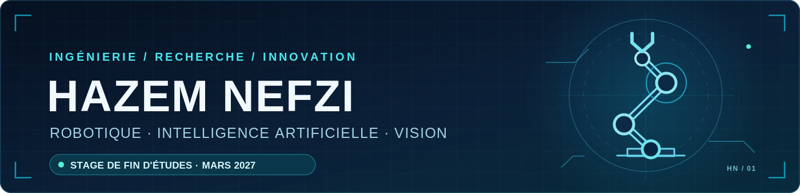

### Élève-ingénieur en mécatronique · Robotique · Intelligence artificielle · Vision par ordinateur

**Double diplôme : SIGMA Clermont (France) & ENISo (Tunisie)**

*De la conception mécanique aux systèmes robotiques intelligents.*

**À la recherche d'un stage de fin d'études de six mois à partir du 15 mars 2027.**

[Présentation](#présentation) · [Compétences](#compétences-techniques) · [Projets](#projets-dingénierie) · [Recherche](#recherche-et-parcours) · [Contact](#me-contacter)

---

## Présentation

Je suis **Hazem NEFZI**, élève-ingénieur en **mécatronique**, en double diplôme à **SIGMA Clermont** et à l'**École nationale d'ingénieurs de Sousse (ENISo)**. Je m'intéresse à la conception de systèmes capables de **percevoir, décider et agir**, à la rencontre de la robotique, de l'automatique, de la mécanique et de l'intelligence artificielle.

Lors de mon stage de recherche à l'**Institut Pascal**, j'ai travaillé sur la **manipulation robotique d'objets déformables**, l'apprentissage par démonstration et la commande avec retour visuel. Mes autres projets m'ont amené à utiliser des robots **UR3e** et **Franka**, à développer des solutions de **vision par ordinateur** et à explorer l'**inspection industrielle automatisée**.

Mon objectif est de contribuer à des projets concrets en **robotique industrielle**, **R&D**, **vision** ou **IA appliquée à l'industrie**.

## Compétences techniques

**Programmation et intelligence artificielle**

**Robotique, perception et simulation**

**Conception et ingénierie mécanique**

## Projets d'ingénierie

> Ces présentations décrivent des travaux réalisés ou en cours de documentation. Les codes sources et démonstrations ne sont pas tous publics à ce jour.

<b>01 · Détection de défauts par inspection robotisée</b> · ROS 2 · UR3e · RealSense D435

Développement d'une approche d'inspection industrielle associant un robot collaboratif et une caméra RGB-D, avec prise de vues sous plusieurs angles et traitement visuel des composants.

**Compétences mobilisées :** ROS 2, intégration robot-capteur, perception, simulation, inspection multi-vues.

<b>02 · Manipulation d'objets déformables</b> · Apprentissage par démonstration · Commande

Travaux de recherche à l'Institut Pascal portant sur la génération de mouvements robotiques et la correction en ligne à partir d'informations sur la forme de l'objet manipulé.

**Compétences mobilisées :** robotique de manipulation, modélisation, contrôle, expérimentation.

*Les éléments non publiés du projet seront partagés uniquement après autorisation.*

<b>03 · Main bionique</b> · Conception mécanique · Mécatronique

Projet de conception d'une main robotique, mettant en œuvre des mécanismes, de la modélisation CAO et des réflexions sur l'intégration mécatronique.

**Compétences mobilisées :** SOLIDWORKS, conception de mécanismes, prototypage.

<b>04 · Asservissement visuel d'un bras robotique</b> · UR3e · ArUco

Expérimentation d'une commande de robot basée sur des informations issues de la caméra, notamment le suivi de repères visuels et les contraintes de visibilité.

**Compétences mobilisées :** asservissement visuel, OpenCV, robotique, validation expérimentale.

<b>05 · Estimation robuste et RANSAC adaptatif</b> · MATLAB

Implémentation et analyse d'algorithmes d'ajustement robuste, avec données aberrantes, stratégies d'itération adaptatives et simulations reproductibles.

**Compétences mobilisées :** MATLAB, algorithmique, mathématiques appliquées, visualisation.

<b>06 · Segmentation d'images industrielles avec SAM 2</b> · PyTorch

Expérimentation de modèles de fondation pour la segmentation d'images industrielles, avec utilisation du GPU et analyse visuelle des résultats.

**Compétences mobilisées :** vision par ordinateur, PyTorch, modèles de segmentation, environnement Linux.

## Recherche et parcours

| Domaine | Expérience ou réalisation |
| :--- | :--- |
| **Recherche** | Stage à l'Institut Pascal : manipulation d'objets déformables et apprentissage par démonstration |
| **Publication scientifique** | Manuscrit en préparation en vue d'une soumission à *IEEE Robotics and Automation Letters (RA-L)*, non encore publié |
| **Certifications CAO** | **CSWA** et **CSWP** SOLIDWORKS |
| **Anglais** | **TOEIC : 955 / 990** |
| **Français** | **TCF : 448 / 699** |
| **Résultats académiques** | Major de promotion en deuxième année à SIGMA Clermont |

## Activité GitHub

Retrouvez mes contributions, les évolutions de mes projets et les dépôts que je rends progressivement accessibles au public.

**[Consulter mes contributions et mon activité sur GitHub](https://github.com/Hazem-NEFZI)**

### Perspectives et projets en développement

Je poursuis le développement de projets associant **robotique, intelligence artificielle, vision par ordinateur et ingénierie mécanique**, avec un intérêt particulier pour les applications industrielles.

Mes travaux s'articulent autour de la **manipulation robotique**, de la **perception intelligente**, de l'**apprentissage automatique** et de l'**optimisation des systèmes industriels**. Je cherche à concevoir des solutions fiables et à les évaluer à travers des expérimentations et des résultats concrets.

## Me contacter

Intéressé par un projet en **robotique**, **IA industrielle**, **vision par ordinateur** ou **mécatronique** ? Découvrez mes réalisations et échangeons autour de nouvelles opportunités.

Concevoir avec rigueur · Expérimenter avec curiosité · Innover avec sens

