### Mechatronics Engineering · Robotics · Artificial Intelligence · Computer Vision

**Double-degree engineering student at SIGMA Clermont & ENISo**

*From mechanical design to intelligent robotic systems.*

**Open to a six-month end-of-studies internship from 15 March 2027**

[About](#about-me) · [Expertise](#engineering-toolkit) · [Projects](#featured-engineering-work) · [Research](#research--highlights) · [Contact](#connect)

---

## About me

I'm **Hazem NEFZI**, a double-degree mechatronics engineering student at **SIGMA Clermont (France)** and **ENISo (Tunisia)**. I enjoy turning engineering ideas into working systems that combine **robotics, mechanical design, control, computer vision and AI**.

At **Institut Pascal**, I worked on **deformable-object manipulation**, learning from demonstration and feedback-driven robot control. I have also developed work involving **UR3e robotic arms, Intel RealSense cameras, visual servoing, calibration, machine learning and industrial inspection**.

I am looking for an **industrial engineering / R&D internship** where I can contribute to robotics, intelligent automation, computer vision or AI-driven manufacturing.

## Engineering toolkit

**Programming & AI**

**Robotics & simulation**

**Mechanical engineering & design**

## Featured engineering work

> Selected work from robotics, AI, computer vision and mechatronics. Detailed public repositories and demonstrations are being prepared; the summaries below describe the projects, not necessarily open-source releases.

<b>01 · Robot-assisted industrial defect detection</b> — ROS 2 · UR3e · RealSense D435

 
A robotic inspection system using an articulated robot and RGB-D perception to inspect industrial components from multiple viewpoints. My work includes robot integration, perception, simulation and defect-detection workflows.

**Focus:** industrial automation · multi-view inspection · vision–robot integration

<b>02 · Deformable-object manipulation</b> — Learning from demonstration · shape feedback

 
Research work at Institut Pascal on robot manipulation of deformable objects using demonstration-based motion generation and online feedback. A research manuscript is being prepared for submission; implementation details will be shared only when authorized.

**Focus:** robot learning · feedback control · research prototyping

<b>03 · Bionic hand</b> — Mechanical design · mechatronics

 
A mechatronic design project exploring the development of a bionic robotic hand, bridging CAD design, mechanisms and implementation considerations.

**Focus:** mechanical design · prototyping · robotic mechanisms

<b>04 · Vision-based robot control</b> — UR3e · ArUco · Visual servoing

 
Robot control using visual feedback and image features, including challenges such as target alignment and maintaining reliable visual observations.

**Focus:** robotics control · visual perception · experimental validation

<b>05 · Robust estimation with adaptive RANSAC</b> — MATLAB

 
Implementation and validation of robust model fitting, including outlier handling, adaptive iteration strategies and reproducible simulations.

**Focus:** numerical algorithms · mathematical modeling · visualization

<b>06 · Industrial image segmentation with SAM 2</b> — PyTorch · Computer vision

 
Hands-on experimentation with foundation-model segmentation for industrial imagery, using GPU-accelerated inference and visual evaluation.

**Focus:** AI models · industrial perception · computer vision

## Research & highlights

- **Institut Pascal — Research internship:** deformable-object manipulation and learning from demonstration.
- **IEEE RA-L:** research manuscript in preparation for submission; not yet published.
- **SOLIDWORKS:** CSWA and CSWP certified.
- **TOEIC:** 965 / 990.
- **Academic distinction:** top of semester at SIGMA Clermont (16.35 / 20).

## GitHub activity

<b>What am I working on next?</b>

 
I am organizing my existing engineering projects into reproducible repositories, improving project documentation and demos, and exploring applications of AI in manufacturing and robotics.

## Connect

If your team works on **robotics, industrial AI, computer vision or advanced mechatronics**, I'd love to connect.

Engineered with curiosity · Developed with precision · Driven by innovation

